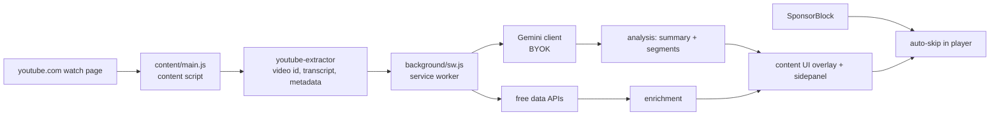
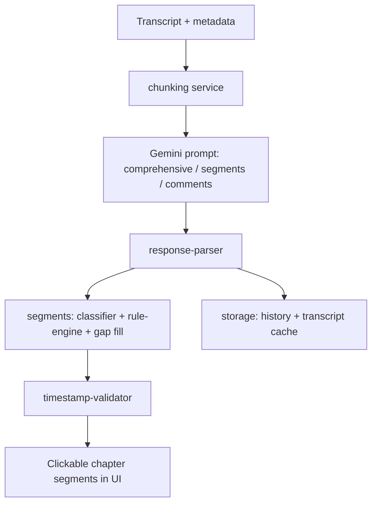

<p align="center">
  <a href="https://github.com/chirag127/youtube-ai-navigator-bs-ext">
    
  </a>
</p>

# YouTube AI Navigator

> AI-powered YouTube insights — summaries, smart segments, interactive transcripts, and sponsor-skipping, right on the watch page.

[](./LICENSE)
[](https://github.com/chirag127/youtube-ai-navigator-bs-ext/stargazers)
[](https://github.com/chirag127/youtube-ai-navigator-bs-ext/commits/main)
[](./extension/manifest.json)
[](https://github.com/chirag127/youtube-ai-navigator-bs-ext/actions/workflows/ci.yml)

## What it is / why it exists

Long YouTube videos bury the good parts under intros, sponsor reads, and filler. **YouTube AI Navigator** is a Manifest V3 browser extension that analyzes the video you're watching with Google Gemini and enriches it with a stack of free, keyless data APIs — so you get an AI summary, jump-to segments, an interactive transcript, and automatic sponsor-skipping without leaving the watch page. Bring your own Gemini key; nothing is stored on a server.

## Links

- **Live site:** [yt-nav.oriz.in](https://yt-nav.oriz.in/)
- **Repo:** https://github.com/chirag127/youtube-ai-navigator-bs-ext
- **Chrome Web Store:** listing pending — until then, [load unpacked](#install) from source.

⭐ **If this is useful, please star the repo — it helps others find it.**

## How it works





## Features

- **AI summaries (Gemini)** — concise, timestamped overview of the current video (bring your own key)
- **Smart segments** — AI + rule-engine chapterization; classifies and skips intros/outros/filler, clickable to seek
- **Interactive transcript** — synchronized, searchable; click any line to jump
- **Integrated SponsorBlock** — auto-skips sponsor/self-promo segments in the player
- **Comment analysis** — summarize and surface key discussion from the comment section
- **Enrichment via free APIs** — DeArrow, TMDB, IGDB, MusicBrainz, Genius, Wikidata, OpenLibrary, Open-Meteo, Semantic Scholar, Google Fact Check, NewsData, Datamuse
- **History & caching** — per-video transcript/analysis cache and browsing history in `chrome.storage`
- **Side panel + popup + options** — control surface, plus an onboarding flow
- **Privacy-first** — YouTube-only content script; your Gemini key stays in local storage, no server

## Tech stack

- **Vanilla JavaScript (ES modules)**, Manifest V3 — no framework, no bundler; loaded straight from `extension/`
- **Google Gemini API** (client with model selection, incl. 2.5 flash/pro)
- **Chrome Extensions APIs**: `storage`, `cookies`; content script matches `*://*.youtube.com/*`
- **Vitest** (jsdom) for tests · **ESLint** + **Prettier** for lint/format
- **GitHub Pages** (custom domain `yt-nav.oriz.in`) for the landing page

## Repo structure

```
extension/
├── manifest.json               # MV3; content script on youtube.com, host_permissions *://*/*
├── background/sw.js            # service worker (orchestrates Gemini + API calls)
├── content/
│   ├── main.js                 # content-script entry
│   ├── youtube-extractor.js    # pulls video id, transcript, metadata
│   ├── features/               # analysis flow, auto-liker
│   ├── segments/ transcript/   # segment + transcript UI
│   └── ui/                     # in-page overlay
├── api/
│   ├── gemini-client.js gemini.js models.js
│   ├── sponsorblock.js dearrow.js tmdb.js igdb.js musicbrainz.js ...  # data providers
│   ├── core/                   # http-client, rate-limiter, error-handler, metrics
│   └── prompts/                # Gemini prompt templates (comprehensive, segments, comments, chat)
├── services/                   # chunking, segments (classifier/rule-engine), storage, cache, video
├── popup/ sidepanel/ options/ onboarding/   # UI surfaces
├── lib/ utils/ assets/         # shared helpers + icons
tests/                          # Vitest suites
index.html                      # landing page (served at yt-nav.oriz.in)
CNAME                           # yt-nav.oriz.in
```

## Screenshots

_Screenshots pending. See the hero banner above and [yt-nav.oriz.in](https://yt-nav.oriz.in/) for a preview._

## Install

**From source (load unpacked):**

1. `git clone https://github.com/chirag127/youtube-ai-navigator-bs-ext.git`
2. Open Chrome → `chrome://extensions/` → toggle **Developer mode** (top-right)
3. Click **Load unpacked** → select the **`extension/`** directory
4. Open any YouTube video; the AI Navigator UI appears on the watch page

## Quick start / configuration

1. Click the extension icon → **Options** (AI Navigator settings)
2. Paste your **Google Gemini API key** and pick a model
3. Open a YouTube video and use the summary / segments / transcript panels

The extension stores settings in the browser, not in `.env` files. Relevant options:

| Setting (Options page) | Purpose                                                   |
| ---------------------- | --------------------------------------------------------- |
| Gemini API key         | Your key for AI summaries / segment analysis (BYOK)       |
| Model                  | Which Gemini model to call                                |
| SponsorBlock           | Enable/disable automatic sponsor-segment skipping         |
| Feature toggles        | Turn individual panels (transcript, comments, enrichment) on/off |

## Development

```bash
git clone https://github.com/chirag127/youtube-ai-navigator-bs-ext.git
cd youtube-ai-navigator-bs-ext
npm install
npm test              # Vitest
npm run lint          # ESLint over extension/**/*.js
npm run format        # Prettier
```

## Part of the oriz family

One of ~80 small, single-purpose products in the **oriz** family. See the rest at [blog.oriz.in](https://blog.oriz.in).

## Cost

The landing page runs **$0 on the Cloudflare/GitHub free tier**. The extension is free and BYOK — cost is only whatever Gemini charges (the free tier covers casual use); the enrichment APIs are keyless/free.

## Contributing

Issues and PRs welcome. Add new data providers under `extension/api/`, new UI under `extension/content/` or `extension/sidepanel/`, and cover behavior with Vitest. Run `npm run lint` before opening a PR.

## Status / roadmap

**Stable** (v2.0.0). In progress: Chrome Web Store listing and expanded segment classification.

## License

MIT — see [`LICENSE`](./LICENSE).

## Author

Chirag Singhal · [chirag@oriz.in](mailto:chirag@oriz.in)

## Acknowledgments

- [Google Gemini API](https://ai.google.dev/) · [SponsorBlock](https://sponsor.ajay.app/) · [DeArrow](https://dearrow.ajay.app/) and the many free data APIs listed above

---

_Conventional commits are the changelog — browse [the commit history](https://github.com/chirag127/youtube-ai-navigator-bs-ext/commits/main)._
